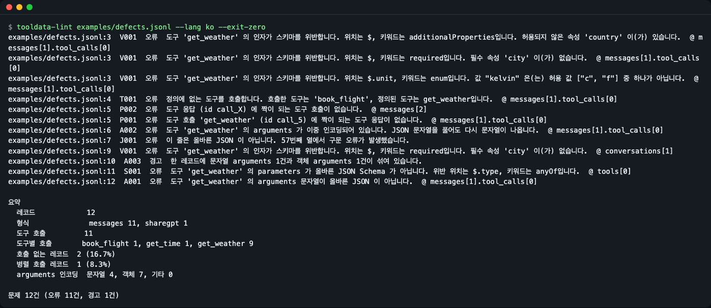
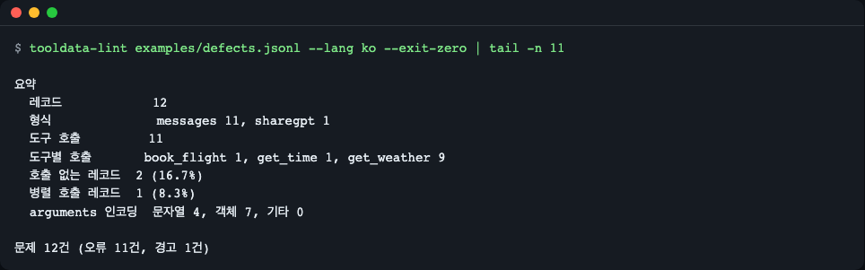
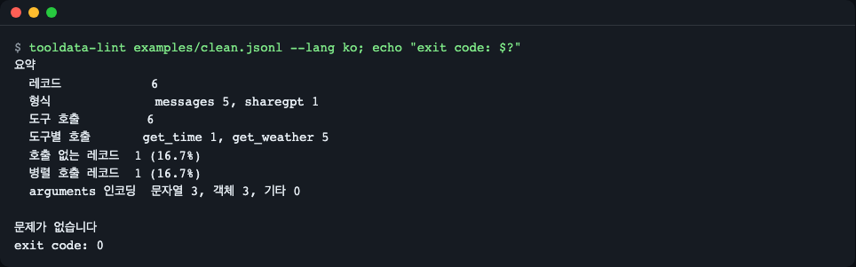
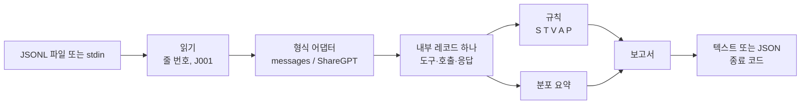

# tooldata-lint

[English](README.md) | **한국어**

도구 호출 파인튜닝 데이터(JSONL)를 학습 전에 검사하는 린터입니다. `tooldata-lint` 는 모든 도구 호출이 도구의 JSON Schema 와 맞는지, 호출과 응답이 짝을 이루는지, `arguments` 인코딩이 일관된지 확인하고, 문제마다 줄 번호와 규칙 코드를 알려 줍니다. 출력 문구는 영어와 한국어를 지원합니다.


*`examples/defects.jsonl` 검사 결과입니다. 3번 줄에는 한 호출의 스키마 위반 3건, 4번 줄에는 정의에 없는 도구, 5번 줄에는 어긋난 짝이 보입니다.*

## 이런 분께

- 도구 호출 모델을 파인튜닝(TRL, Axolotl, Unsloth, LLaMA-Factory, OpenAI 파인튜닝)하면서 데이터 결함을 학습 뒤가 아니라 학습 전에 잡고 싶은 분
- 합성한 도구 호출 대화를 만들고, 나쁜 레코드가 있으면 실패하는 CI 마지막 단계가 필요한 분
- OpenAI 형식(`arguments` 가 JSON 문자열)과 Hugging Face 형식(`arguments` 가 객체) 사이에서 데이터를 옮기며, 둘이 섞인 레코드를 찾고 싶은 분

## 왜 필요한가요

파인튜닝된 모델은 데이터에 보이는 것만 배웁니다. 스키마가 `c` 나 `f` 만 허용하는데 `"unit": "kelvin"` 으로 호출하거나, 호출에 짝이 되는 도구 응답이 없어도 학습은 실패하지 않습니다. 모델이 결함을 조용히 배우고, 나중에 "모델이 엉뚱한 인자를 만든다" 로 드러납니다. 이 도구는 그 발견을 학습 전으로 앞당깁니다.

도구 호출 레코드에는 서로 맞아야 하는 세 부분이 있습니다. **도구 정의**(이름과 파라미터의 JSON Schema), 어시스턴트가 하는 **호출**, 그리고 호출에 답하는 **도구 응답**입니다.


- 호출은 정의된 도구를 불러야 하고(`T001`), 인자는 그 도구의 스키마를 만족해야 합니다(`V001`).
- 호출마다 응답이 하나씩, 응답마다 호출이 하나씩 있어야 합니다(`P001`, `P002`).

## 설치

Python 3.10 이상이 필요합니다. 실행은 [uv](https://docs.astral.sh/uv/) 가 가장 쉽습니다(`curl -LsSf https://astral.sh/uv/install.sh | sh`). 최소 리눅스 이미지에서는 `git` 과 `curl` 도 필요합니다.

```bash
git clone https://github.com/LeeGyeongPil/tooldata-lint
cd tooldata-lint
uv run tooldata-lint --version
```

```text
tooldata-lint 0.1.1
```

`uv tool install git+https://github.com/LeeGyeongPil/tooldata-lint` 로도 설치할 수 있게 준비되어 있고, PyPI 에 올라가면 `uvx tooldata-lint` 로 바로 실행할 수 있습니다.

## 빠르게 시작하기

레포에는 샘플 파일이 둘 있습니다. 결함이 없는 `examples/clean.jsonl`, 종류별 결함이 하나씩 들어 있는 `examples/defects.jsonl` 입니다.

```bash
uv run tooldata-lint examples/defects.jsonl --lang ko --exit-zero
```

```text
examples/defects.jsonl:3  V001  오류  도구 'get_weather' 의 인자가 스키마를 위반합니다. 위치는 $, 키워드는 additionalProperties입니다. 허용되지 않은 속성 'country' 이(가) 있습니다.  @ messages[1].tool_calls[0]
examples/defects.jsonl:3  V001  오류  도구 'get_weather' 의 인자가 스키마를 위반합니다. 위치는 $, 키워드는 required입니다. 필수 속성 'city' 이(가) 없습니다.  @ messages[1].tool_calls[0]
examples/defects.jsonl:3  V001  오류  도구 'get_weather' 의 인자가 스키마를 위반합니다. 위치는 $.unit, 키워드는 enum입니다. 값 "kelvin" 은(는) 허용 값 ["c", "f"] 중 하나가 아닙니다.  @ messages[1].tool_calls[0]
examples/defects.jsonl:4  T001  오류  정의에 없는 도구를 호출합니다. 호출한 도구는 'book_flight', 정의된 도구는 get_weather입니다.  @ messages[1].tool_calls[0]
examples/defects.jsonl:5  P002  오류  도구 응답 (id call_X) 에 짝이 되는 도구 호출이 없습니다.  @ messages[2]
examples/defects.jsonl:5  P001  오류  도구 호출 'get_weather' (id call_5) 에 짝이 되는 도구 응답이 없습니다.  @ messages[1].tool_calls[0]
examples/defects.jsonl:6  A002  오류  도구 'get_weather' 의 arguments 가 이중 인코딩되어 있습니다. JSON 문자열을 풀어도 다시 문자열이 나옵니다.  @ messages[1].tool_calls[0]
examples/defects.jsonl:7  J001  오류  이 줄은 올바른 JSON 이 아닙니다. 57번째 열에서 구문 오류가 발생했습니다.
examples/defects.jsonl:9  V001  오류  도구 'get_weather' 의 인자가 스키마를 위반합니다. 위치는 $, 키워드는 required입니다. 필수 속성 'city' 이(가) 없습니다.  @ conversations[1]
examples/defects.jsonl:10  A003  경고  한 레코드에 문자열 arguments 1건과 객체 arguments 1건이 섞여 있습니다.
examples/defects.jsonl:11  S001  오류  도구 'get_weather' 의 parameters 가 올바른 JSON Schema 가 아닙니다. 위반 위치는 $.type, 키워드는 anyOf입니다.  @ tools[0]
examples/defects.jsonl:12  A001  오류  도구 'get_weather' 의 arguments 문자열이 올바른 JSON 이 아닙니다.  @ messages[1].tool_calls[0]

요약
  레코드            12
  형식              messages 11, sharegpt 1
  도구 호출         11
  도구별 호출       book_flight 1, get_time 1, get_weather 9
  호출 없는 레코드  2 (16.7%)
  병렬 호출 레코드  1 (8.3%)
  arguments 인코딩  문자열 4, 객체 7, 기타 0

문제 12건 (오류 11건, 경고 1건)
```

한 줄 읽는 법: `파일:줄  코드  심각도  메시지  @ 위치`.

- `줄` 은 파일의 1부터 시작하는 줄 번호라서 바로 찾아갈 수 있습니다.
- 3번 줄은 스키마 오류를 첫 번째만이 아니라 **전부** 알려 주는 이유를 보여 줍니다. 한 호출이 `enum`, `required`, `additionalProperties` 를 동시에 위반하고 있어서, 첫 오류만 고치면 나머지 둘이 남습니다. 메시지에는 JSON 경로(`$.unit`)와 실패한 키워드(`enum`)가 들어 있습니다.
- 7번 줄은 올바른 JSON 이 아닙니다. `J001` 로 알리고 8번 줄부터 계속 검사합니다.
- `--exit-zero` 는 종료 코드를 0 으로 만들어 데모가 실패한 명령처럼 보이지 않게 합니다. 이 옵션이 없으면 위 명령은 종료 코드 1 로 끝납니다.

결함이 없는 파일은 `문제가 없습니다` 로 끝나고 종료 코드 0 입니다.

```bash
uv run tooldata-lint examples/clean.jsonl --lang ko
```

```text
요약
  레코드            6
  형식              messages 5, sharegpt 1
  도구 호출         6
  도구별 호출       get_time 1, get_weather 5
  호출 없는 레코드  1 (16.7%)
  병렬 호출 레코드  1 (16.7%)
  arguments 인코딩  문자열 3, 객체 3, 기타 0

문제가 없습니다
```

요약은 데이터 분포를 한눈에 보여 줍니다. "호출 없는 레코드" 가 0% 라면 모델은 도구를 부르지 않고 답해야 하는 예시를 한 번도 보지 못합니다.


*요약 블록입니다. 형식, 도구별 호출 수, 호출 없는 레코드, 병렬 호출, arguments 인코딩이 보입니다.*


*결함 없는 파일은 종료 코드 0 으로 끝나므로 파이프라인의 관문으로 쓸 수 있습니다.*

## 사용법

```text
tooldata-lint [--format FORMAT] [-o OUT] [--fail-on LEVEL] [--ignore CODES]
              [--exit-zero] [--lang LANG] [--version] [-h]
              FILE [FILE ...]
```

| 옵션 | 하는 일 | 예 |
|---|---|---|
| `FILE ...` | 검사할 JSONL 파일. `-` 는 표준 입력을 읽습니다. | `tooldata-lint train.jsonl val.jsonl` |
| `--format text\|json` | 사람이 읽는 텍스트(기본) 또는 JSON 보고서. | `--format json` |
| `-o, --output OUT` | 보고서를 표준 출력 대신 파일에 씁니다. | `-o report.json` |
| `--fail-on error\|warning` | 종료 코드를 1 로 만드는 가장 낮은 심각도(기본 `error`). | `--fail-on warning` |
| `--ignore CODES` | 출력과 종료 코드에서 뺄 규칙 코드(쉼표 구분). | `--ignore J001,P004` |
| `--exit-zero` | 문제가 있어도 항상 종료 코드 0. | `--exit-zero` |
| `--lang en\|ko` | 출력 언어. [설정](#설정) 참고. | `--lang ko` |
| `--version` | 버전을 표시합니다. | |

종료 코드: `0` 선택한 수준에서 문제 없음, `1` 문제 발견, `2` 도구 오류(잘못된 사용법, 읽을 수 없는 입력 파일, 쓸 수 없는 출력 파일, 내부 오류). 역추적(traceback)으로 끝나는 경우는 없습니다. [docs/rules.ko.md](docs/rules.ko.md#종료-코드) 를 참고하세요.

**표준 입력으로 넘기기.**

```bash
cat examples/defects.jsonl | uv run tooldata-lint - --lang ko --exit-zero | tail -n 3
```

```text
  arguments 인코딩  문자열 4, 객체 7, 기타 0

문제 12건 (오류 11건, 경고 1건)
```

**규칙 무시와 경고 실패.** `V001` 과 `J001` 을 빼면 나머지 결과만 남고, `--fail-on warning` 은 하나뿐인 경고도 실패로 칩니다.

```bash
uv run tooldata-lint examples/defects.jsonl --lang ko --ignore V001,J001 --fail-on warning | tail -n 1
```

```text
문제 7건 (오류 6건, 경고 1건)
```

**기계가 읽는 출력.** `--format json` 은 `tool`, `version`, `files`, `counts`, `issues`, `summary` 를 출력합니다. 키·규칙 코드·심각도 값은 언어와 무관하고 `message` 만 현지화됩니다.

```bash
uv run tooldata-lint examples/defects.jsonl --lang ko --format json -o report.json
```

```text
보고서를 report.json 에 저장했습니다.
```

이 명령은 파일에 오류가 있으므로 종료 코드 1 로 끝납니다.

**도구 오류는 종료 코드 2** 로 끝나므로 CI 에서 "문제 발견"(1)과 구분할 수 있습니다.

```bash
uv run tooldata-lint nope.jsonl --lang ko
uv run tooldata-lint examples/clean.jsonl -o /nonexistent/d/r.json --lang ko
```

```text
tooldata-lint: 오류: 'nope.jsonl' 파일을 열 수 없습니다. 파일이 없습니다.
tooldata-lint: 오류: '/nonexistent/d/r.json' 파일에 쓸 수 없습니다. 경로 또는 상위 디렉터리가 없습니다.
```

### 규칙

| 코드 | 심각도 | 뜻 |
|---|---|---|
| J001 | 오류 | 줄이 올바른 JSON 이 아닙니다. 검사는 계속됩니다. |
| U001 | 경고 | 알 수 없는 형식의 레코드라 건너뜁니다. 또는 파일에 레코드가 하나도 없습니다(빈 파일, 빈 줄뿐). |
| S001 | 오류 | 도구의 `parameters` 가 올바른 JSON Schema 가 아닙니다. |
| T001 | 오류 | 레코드에 정의되지 않은 도구를 호출했습니다. |
| T002 | 오류 | 호출은 있는데 레코드에 도구 정의가 전혀 없습니다. |
| V001 | 오류 | 인자가 도구의 JSON Schema 를 위반합니다(위반마다 1건). |
| A001 | 오류 | `arguments` 문자열이 올바른 JSON 이 아닙니다. |
| A002 | 오류 | `arguments` 가 이중 인코딩되어 있습니다(풀어도 문자열). |
| A003 | 경고 | 한 레코드에 문자열·객체 `arguments` 가 섞여 있습니다. |
| P001 | 오류 | 호출 뒤로 대화가 이어지는데 도구 응답이 없습니다. 레코드의 마지막 메시지에 있는 호출은 학습 정답(OpenAI 파인튜닝 형태)이라 보고하지 않습니다. |
| P002 | 오류 | 도구 응답에 짝이 되는 호출이 없습니다. |
| P003 | 오류 | 한 레코드 안에 같은 호출 id 가 두 번 나옵니다. |
| P004 | 경고 | 일부 호출에만 id 가 있습니다. |

규칙별 원인과 고치는 법은 [docs/rules.ko.md](docs/rules.ko.md) 에 있습니다.

### 지원 형식

형식은 줄마다 감지합니다. 모든 형식을 하나의 내부 레코드로 바꾼 뒤 같은 규칙을 적용합니다.

| 형식 | 감지 기준 | 참고 |
|---|---|---|
| OpenAI | `messages` | `arguments` 가 JSON 문자열이고 호출에 id 가 있습니다. |
| Hugging Face / TRL / Axolotl | `messages` | `arguments` 가 객체이고 id 가 없을 수 있습니다. `tools` 는 목록이나 JSON 문자열 모두 가능합니다. |
| ShareGPT (LLaMA-Factory) | `conversations` | `function_call`·`observation` 턴. `function_call` 턴의 배열은 병렬 호출입니다. |

레코드에 id 가 하나라도 있으면 id 로 응답을 호출과 짝짓습니다. 하나도 없으면(Hugging Face 데이터에 흔합니다) 순서로 짝짓고, 이를 오류로 보고하지 않습니다.

### 파이썬에서 쓰기

내 프로젝트에 라이브러리로 설치하려면 `uv add git+https://github.com/LeeGyeongPil/tooldata-lint` (또는 `pip install git+https://github.com/LeeGyeongPil/tooldata-lint`, PyPI 에 올라가면 `pip install tooldata-lint`)를 씁니다.

```python
import json
from tooldata_lint import lint_file, lint_record

report = lint_file("examples/defects.jsonl")
print(report.exit_code(), len(report.issues), report.summary.records)

kept = []
with open("examples/clean.jsonl", encoding="utf-8") as f:
    for number, line in enumerate(f, start=1):
        record = json.loads(line)
        if not lint_record(record, line=number):
            kept.append(record)
print(len(kept))
```

```text
1 12 12
6
```

`lint_record` 는 `Issue` 객체(`code`, `severity`, `message`, `line`, `json_path`, `keyword` 등)의 목록을 돌려줍니다. 데이터 결함은 예외가 아니라 Issue 로 돌려주고, `lint_file` 은 파일을 열 수 없을 때만 `InputError` 를 냅니다.

## 설정

| 설정 | 값 | 기본값 |
|---|---|---|
| `--lang` | `en`, `ko` | 아래 참고 |
| `TOOLDATA_LINT_LANG` | `en`, `ko` | 없음 |

언어는 `--lang`, `TOOLDATA_LINT_LANG`, `LC_ALL`, `LC_MESSAGES`, `LANG` 순으로 정합니다. 값이 `ko` 로 시작하면 한국어, 그 밖에는 영어입니다. 도움말·사용법·인자 오류·검사 결과·요약이 모두 현지화됩니다.

```bash
TOOLDATA_LINT_LANG=en uv run tooldata-lint examples/clean.jsonl
```

```text
Summary
  records                      6
  formats                      messages 5, sharegpt 1
  tool calls                   6
  calls per tool               get_time 1, get_weather 5
  records without calls        1 (16.7%)
  records with parallel calls  1 (16.7%)
  arguments encoding           string 3, object 3, other 0

No problems found
```

API 키·네트워크·GPU 는 필요 없습니다.

## 동작 원리



1. 읽기 단계가 파일을 한 줄씩 스트리밍하므로 큰 파일도 괜찮고, 깨진 줄은 실행을 멈추지 않고 `J001` 이 됩니다.
2. 어댑터가 모든 형식을 같은 내부 레코드로 바꾸므로 어떤 규칙도 형식에 의존하지 않습니다.
3. 호출과 응답의 짝을 먼저 정하고 그다음 인자를 검사합니다. 하나의 결함이 여러 후속 결과를 만들지 않게 하려는 것입니다(예: 이중 인코딩된 호출이 "호출 없는 응답" 까지 만들지 않습니다).
4. 인자는 [jsonschema](https://python-jsonschema.readthedocs.io/) 로 검증하고, 모든 오류를 JSON 경로·키워드와 함께 모읍니다. 검증기는 스키마별로 캐시합니다.

## CI 에서 쓰기

종료 코드가 관문입니다. `0` 은 통과, `1` 은 데이터 문제, `2` 는 도구 자체를 실행하지 못했다는 뜻입니다. 아래 GitHub Actions 작업은 `data/` 아래 모든 JSONL 파일을 검사하고, 경고(빈 파일 `U001` 포함)에도 실패하며, JSON 보고서를 남깁니다.

```yaml
name: data-lint
on: [push, pull_request]
jobs:
  lint:
    runs-on: ubuntu-latest
    steps:
      - uses: actions/checkout@v6.1.0
      - uses: astral-sh/setup-uv@v10.3.3
      - name: Lint tool-call data
        run: uvx --from git+https://github.com/LeeGyeongPil/tooldata-lint tooldata-lint data/*.jsonl --fail-on warning --format json -o report.json
      - uses: actions/upload-artifact@v4
        if: always()
        with:
          name: tooldata-lint-report
          path: report.json
```

이 레포의 워크플로도 샘플 파일에 같은 방식의 종료 코드 검사를 합니다: [.github/workflows/ci.yml](.github/workflows/ci.yml). SARIF 출력은 아직 없습니다([한계](#한계) 참고). PyPI 에 올라가면 `--from` 부분 없이 `uvx tooldata-lint ...` 로 쓸 수 있습니다.

## 한계

- `messages`(OpenAI, Hugging Face, TRL, Axolotl) 또는 `conversations`(ShareGPT) 레코드의 JSONL 파일만 검사합니다. 다른 구조(Glaive, xLAM, Hermes)는 `U001` 로 건너뜁니다.
- `arguments` 가 이중 인코딩(`A002`)이면 검증할 객체가 없으므로 안쪽 객체는 스키마 검증을 하지 않습니다.
- 도구의 JSON Schema 에 대해서만 인자를 검사하며, 모델의 채팅 템플릿에 대한 검사는 아닙니다. Hermes·템플릿 검사는 계획일 뿐 아직 없습니다.
- 같은 줄의 결과는 규칙 코드순이 아니라 발견한 순서로 나옵니다(예: `P002` 가 `P001` 보다 먼저 나올 수 있음).
- 풀 수 없는 `$ref`(없는 로컬 정의, 원격 URL)는 `S001` 로 보고합니다. 원격 참조는 내려받지 않습니다.
- 중복·개인정보·역할 순서·토큰 길이 같은 일반 데이터셋 문제는 찾지 않습니다.

## 언제 쓰나

- 잘 맞는 경우: 모델이나 네트워크 없이, 줄 번호가 붙은 JSONL 에 대해 도구 호출 전용 검사(스키마, 미정의 도구, 짝, 인코딩)를 로컬이나 CI 단계에서 하고 싶을 때입니다.
- 역할 순서·중복·개인정보·토큰 길이 같은 일반 SFT 검사는 다루지 않습니다. [parallelogram](https://pypi.org/project/parallelogram/) 같은 범용 데이터셋 린터와 함께 쓰세요.
- OpenAI 업로드용 형식 점검만 필요하다면 [OpenAI 파인튜닝 데이터 준비 노트북](https://developers.openai.com/cookbook/examples/chat_finetuning_data_prep)이 출발점이 됩니다. 학습 데이터가 아니라 에이전트 실행 기록을 검증하려면 [toolcall-linter](https://pypi.org/project/toolcall-linter/) 를 살펴보세요.

## 로드맵

이번 릴리스에 없는 것: 대상 모델 채팅 템플릿에서의 `arguments` 검사, SARIF 출력, 도구 정의 지문과 `--tools-ref` 비교, Hermes 레코드(다음 예정), `--fix` 와 Glaive·xLAM 레코드(그다음). 나오면 README 를 고치겠습니다.

## 자주 겪는 문제

| 증상 | 원인 | 해결 |
|---|---|---|
| 스크립트에서 종료 코드 1 인데 보고서는 멀쩡해 보임 | 문제가 발견되었다는 의도된 신호입니다 | 데이터를 고치거나, 보고만 하려면 `--exit-zero` 를 씁니다 |
| 많은 줄에서 `U001` | 레코드가 `messages` 도 `conversations` 도 아닙니다(예: Glaive·xLAM 형식) | 먼저 변환하세요. 아직 지원하지 않는 형식입니다 |
| 한 데이터셋의 모든 레코드에서 `S001` | 도구 파라미터가 표준 JSON Schema 가 아닙니다(예: `"type": "int"`) | 파라미터를 JSON Schema 로 변환하세요 |
| `T002` | 호출은 있는데 레코드에 `tools` 가 없습니다 | 레코드마다 `tools` 를 넣으세요 |
| `U001` "파일에 레코드가 없습니다" | 파일이 비었거나 빈 줄뿐입니다. 파이프라인 단계가 아무것도 쓰지 못한 경우가 많습니다 | 그 단계를 고치세요. `--fail-on warning` 이면 CI 가 실패합니다 |
| 레코드 끝의 호출에 `P001` 이 안 나옴 | 마지막 메시지의 호출은 학습 정답이라 응답이 필요 없습니다 | 고칠 것 없음. 호출 뒤에 메시지가 더 이어지는데 응답이 없으면 보고됩니다 |
| OpenAI 데이터에서 `P004` 경고 | 일부 호출에만 id 가 있습니다 | 모든 호출에 id 를 넣거나 모두 빼세요 |
| 기대한 언어로 나오지 않음 | 우선순위가 더 높은 설정이 이깁니다 | `--lang en` 또는 `--lang ko` 를 직접 지정하세요 |

## 개발

```bash
uv run pytest
```

```text
all tests passed
```

버그와 제안은 이슈로 남겨 주세요. 변경 기록은 [CHANGELOG.md](CHANGELOG.md) 에 있습니다.

## 라이선스

MIT. `examples/` 와 `tests/fixtures/` 의 샘플 데이터는 이 프로젝트를 위해 직접 쓴 것이며 가상의 도구를 씁니다.
