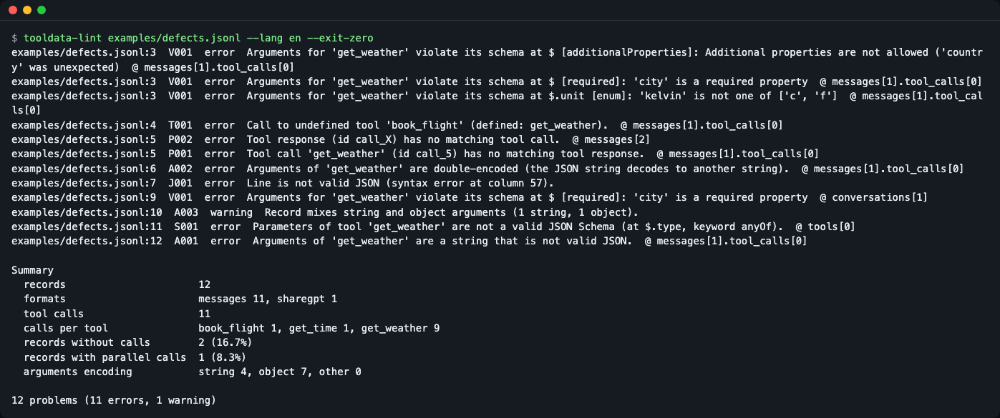
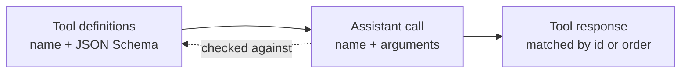
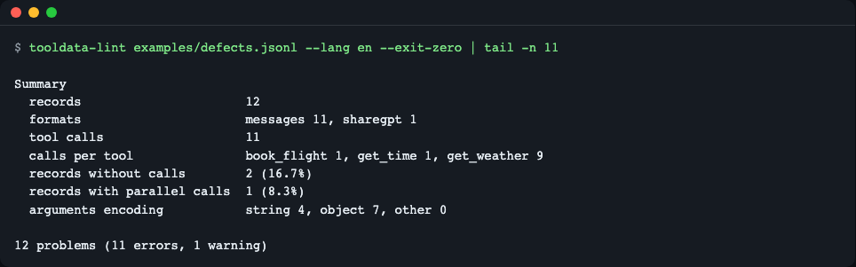
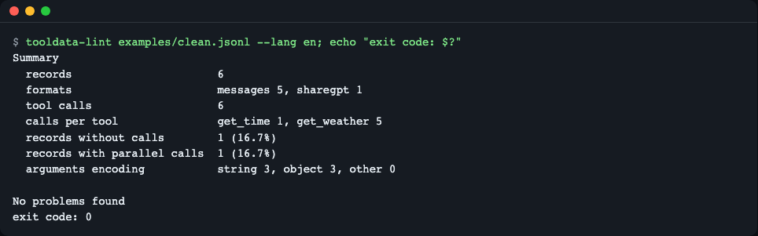
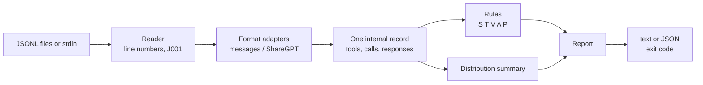

# tooldata-lint

**English** | [한국어](README.ko.md)

Lint tool-calling fine-tuning data (JSONL) before you train. `tooldata-lint` checks that every tool call matches the tool's JSON Schema, that calls and responses pair up, and that `arguments` are encoded consistently, and it reports each problem with a line number and a rule code. Messages are available in English and Korean.


*`tooldata-lint` on `examples/defects.jsonl`: three schema violations of one call on line 3, an undefined tool on line 4, a broken pair on line 5, and so on.*

## Who it is for

- You fine-tune a model for tool calling (TRL, Axolotl, Unsloth, LLaMA-Factory, or OpenAI fine-tuning) and want to catch data defects before the run, not after.
- You generate synthetic tool-call conversations and want a last CI step that fails on bad records.
- You convert data between the OpenAI format (`arguments` is a JSON string) and the Hugging Face format (`arguments` is an object) and want to see which records mix the two.

## Why

A fine-tuned model only learns what the data shows. If a record calls a tool with `"unit": "kelvin"` when the schema allows `c` or `f`, or the call has no matching tool response, the training run does not fail. The model quietly learns the defect, and you notice it later as "the model invents wrong arguments". This tool moves that discovery to before training.

A tool-call record has three parts that must agree: the **tool definitions** (name and JSON Schema of the parameters), the **calls** the assistant makes, and the **tool responses** that answer them.



- A call must name a tool that is defined (`T001`) and its arguments must satisfy that tool's schema (`V001`).
- Each call needs exactly one response and each response needs a call (`P001`, `P002`).

## Install

Requires Python 3.10 or newer. [uv](https://docs.astral.sh/uv/) is the easiest way to run it (`curl -LsSf https://astral.sh/uv/install.sh | sh`). On a minimal Linux image you also need `git` and `curl`.

```bash
git clone https://github.com/LeeGyeongPil/tooldata-lint
cd tooldata-lint
uv run tooldata-lint --version
```

```text
tooldata-lint 0.1.1
```

The package is also prepared for `uv tool install git+https://github.com/LeeGyeongPil/tooldata-lint` and, once published on PyPI, `uvx tooldata-lint`.

## Quick start

The repository ships two sample files: `examples/clean.jsonl` (no defects) and `examples/defects.jsonl` (one defect per kind).

```bash
uv run tooldata-lint examples/defects.jsonl --exit-zero
```

```text
examples/defects.jsonl:3  V001  error  Arguments for 'get_weather' violate its schema at $ [additionalProperties]: Additional properties are not allowed ('country' was unexpected)  @ messages[1].tool_calls[0]
examples/defects.jsonl:3  V001  error  Arguments for 'get_weather' violate its schema at $ [required]: 'city' is a required property  @ messages[1].tool_calls[0]
examples/defects.jsonl:3  V001  error  Arguments for 'get_weather' violate its schema at $.unit [enum]: 'kelvin' is not one of ['c', 'f']  @ messages[1].tool_calls[0]
examples/defects.jsonl:4  T001  error  Call to undefined tool 'book_flight' (defined: get_weather).  @ messages[1].tool_calls[0]
examples/defects.jsonl:5  P002  error  Tool response (id call_X) has no matching tool call.  @ messages[2]
examples/defects.jsonl:5  P001  error  Tool call 'get_weather' (id call_5) has no matching tool response.  @ messages[1].tool_calls[0]
examples/defects.jsonl:6  A002  error  Arguments of 'get_weather' are double-encoded (the JSON string decodes to another string).  @ messages[1].tool_calls[0]
examples/defects.jsonl:7  J001  error  Line is not valid JSON (syntax error at column 57).
examples/defects.jsonl:9  V001  error  Arguments for 'get_weather' violate its schema at $ [required]: 'city' is a required property  @ conversations[1]
examples/defects.jsonl:10  A003  warning  Record mixes string and object arguments (1 string, 1 object).
examples/defects.jsonl:11  S001  error  Parameters of tool 'get_weather' are not a valid JSON Schema (at $.type, keyword anyOf).  @ tools[0]
examples/defects.jsonl:12  A001  error  Arguments of 'get_weather' are a string that is not valid JSON.  @ messages[1].tool_calls[0]

Summary
  records                      12
  formats                      messages 11, sharegpt 1
  tool calls                   11
  calls per tool               book_flight 1, get_time 1, get_weather 9
  records without calls        2 (16.7%)
  records with parallel calls  1 (8.3%)
  arguments encoding           string 4, object 7, other 0

12 problems (11 errors, 1 warning)
```

How to read a line: `file:line  CODE  severity  message  @ location`.

- `line` is the 1-based line number in the file, so you can jump straight to it.
- Line 3 shows why **all** schema errors are reported, not only the first: one call violates `enum`, `required` and `additionalProperties` at once, and fixing only the first would leave the other two. The message gives the JSON path (`$.unit`) and the failing keyword (`[enum]`).
- Line 7 is not valid JSON. It is reported as `J001` and the check continues with line 8.
- `--exit-zero` makes the exit code 0 so the demo does not look like a failed command. Without it the command above exits with 1.

A clean file ends with `No problems found` and exits with 0:

```bash
uv run tooldata-lint examples/clean.jsonl
```

```text
Summary
  records                      6
  formats                      messages 5, sharegpt 1
  tool calls                   6
  calls per tool               get_time 1, get_weather 5
  records without calls        1 (16.7%)
  records with parallel calls  1 (16.7%)
  arguments encoding           string 3, object 3, other 0

No problems found
```

The summary is a quick look at your data distribution. "records without calls" at 0% means the model never sees an example where it should answer without calling a tool.


*The summary block: formats, calls per tool, records without calls, parallel calls and argument encodings.*


*A clean file exits with 0, so it can gate a pipeline.*

## Usage

```text
tooldata-lint [--format FORMAT] [-o OUT] [--fail-on LEVEL] [--ignore CODES]
              [--exit-zero] [--lang LANG] [--version] [-h]
              FILE [FILE ...]
```

| Option | What it does | Example |
|---|---|---|
| `FILE ...` | JSONL files to check. `-` reads standard input. | `tooldata-lint train.jsonl val.jsonl` |
| `--format text\|json` | Human-readable text (default) or a JSON report. | `--format json` |
| `-o, --output OUT` | Write the report to a file instead of standard output. | `-o report.json` |
| `--fail-on error\|warning` | Lowest severity that makes the exit code 1 (default `error`). | `--fail-on warning` |
| `--ignore CODES` | Comma-separated rule codes to drop from the output and the exit code. | `--ignore J001,P004` |
| `--exit-zero` | Always exit with 0, even if problems are found. | `--exit-zero` |
| `--lang en\|ko` | Output language, see [Configuration](#configuration). | `--lang ko` |
| `--version` | Print the version. | |

Exit codes: `0` no problems at the chosen level, `1` problems found, `2` tool error (wrong usage, an unreadable input file, an output file that cannot be written, or an internal error). The tool never ends with a traceback. See [docs/rules.md](docs/rules.md#exit-codes).

**Pipe data in.**

```bash
cat examples/defects.jsonl | uv run tooldata-lint - --exit-zero | tail -n 3
```

```text
  arguments encoding           string 4, object 7, other 0

12 problems (11 errors, 1 warning)
```

**Ignore a rule and make warnings fail.** Dropping `V001` and `J001` leaves the other findings, and `--fail-on warning` makes even the lone warning count:

```bash
uv run tooldata-lint examples/defects.jsonl --ignore V001,J001 --fail-on warning | tail -n 1
```

```text
7 problems (6 errors, 1 warning)
```

**Machine-readable output.** `--format json` prints `tool`, `version`, `files`, `counts`, `issues` and `summary`. Keys, rule codes and severity values do not depend on the language; only `message` is localized.

```bash
uv run tooldata-lint examples/defects.jsonl --format json -o report.json
```

```text
Report written to report.json.
```

This command exits with 1 because the file has errors.

**Tool errors exit with 2**, which CI can tell apart from "problems found" (1).

```bash
uv run tooldata-lint nope.jsonl
uv run tooldata-lint examples/clean.jsonl -o /nonexistent/d/r.json
```

```text
tooldata-lint: error: Cannot open 'nope.jsonl': the file does not exist.
tooldata-lint: error: Cannot write '/nonexistent/d/r.json': the path or its directory does not exist
```

### Rules

| Code | Severity | Meaning |
|---|---|---|
| J001 | error | The line is not valid JSON. Linting continues. |
| U001 | warning | Record has an unknown format and is skipped, or the file has no records at all (empty or only blank lines). |
| S001 | error | A tool's `parameters` is not a valid JSON Schema. |
| T001 | error | The call names a tool that is not defined in the record. |
| T002 | error | The record has calls but no tool definitions at all. |
| V001 | error | Arguments violate the tool's JSON Schema (one finding per violation). |
| A001 | error | `arguments` is a string that is not valid JSON. |
| A002 | error | `arguments` is double-encoded (decodes to another string). |
| A003 | warning | One record mixes string and object `arguments`. |
| P001 | error | A call has no tool response although the conversation continues after it. A call in the last message of a record is the training label (OpenAI fine-tuning layout) and is not reported. |
| P002 | error | A tool response has no matching call. |
| P003 | error | The same call id appears twice in a record. |
| P004 | warning | Some calls have ids and some do not. |

Each rule with its cause and fix: [docs/rules.md](docs/rules.md).

### Supported formats

The format is detected per line. Every format is converted to one internal record, so the same rules run on all of them.

| Format | Detected by | Notes |
|---|---|---|
| OpenAI | `messages` | `arguments` is a JSON string, calls carry ids. |
| Hugging Face / TRL / Axolotl | `messages` | `arguments` is an object, ids may be missing. `tools` may be a list or a JSON string. |
| ShareGPT (LLaMA-Factory) | `conversations` | `function_call` and `observation` turns. An array in a `function_call` turn means parallel calls. |

If a record has any id, responses are paired with calls by id. If it has none (common in Hugging Face data), they are paired in order, and that is not reported as an error.

### Use it from Python

Install it as a library in your own project with `uv add git+https://github.com/LeeGyeongPil/tooldata-lint` (or `pip install git+https://github.com/LeeGyeongPil/tooldata-lint`; `pip install tooldata-lint` once it is on PyPI).

```python
import json
from tooldata_lint import lint_file, lint_record

report = lint_file("examples/defects.jsonl")
print(report.exit_code(), len(report.issues), report.summary.records)

kept = []
with open("examples/clean.jsonl", encoding="utf-8") as f:
    for number, line in enumerate(f, start=1):
        record = json.loads(line)
        if not lint_record(record, line=number):
            kept.append(record)
print(len(kept))
```

```text
1 12 12
6
```

`lint_record` returns a list of `Issue` objects (`code`, `severity`, `message`, `line`, `json_path`, `keyword`, ...). Data defects are returned as issues, not raised as exceptions; `lint_file` raises `InputError` only when the file cannot be opened.

## Configuration

| Setting | Values | Default |
|---|---|---|
| `--lang` | `en`, `ko` | see below |
| `TOOLDATA_LINT_LANG` | `en`, `ko` | unset |

The language is chosen in this order: `--lang`, then `TOOLDATA_LINT_LANG`, then `LC_ALL`, `LC_MESSAGES` and `LANG`. A value starting with `ko` selects Korean; anything else selects English. Help, usage, argument errors, findings and the summary are all localized.

```bash
TOOLDATA_LINT_LANG=ko uv run tooldata-lint examples/clean.jsonl
```

```text
요약
  레코드            6
  형식              messages 5, sharegpt 1
  도구 호출         6
  도구별 호출       get_time 1, get_weather 5
  호출 없는 레코드  1 (16.7%)
  병렬 호출 레코드  1 (16.7%)
  arguments 인코딩  문자열 3, 객체 3, 기타 0

문제가 없습니다
```

No API key, network access or GPU is needed.

## How it works



1. The reader streams the file line by line, so large files are fine, and a broken line becomes `J001` instead of stopping the run.
2. An adapter converts each format into the same internal record, so no rule depends on a format.
3. Pairing of calls and responses is decided first, then arguments are checked. That keeps one defect from causing several follow-up findings (for example, a double-encoded call does not also produce a "response without call").
4. Arguments are validated with [jsonschema](https://python-jsonschema.readthedocs.io/) and every error is collected, with its JSON path and keyword. Validators are cached per schema.

## Use in CI

The exit code is the gate: `0` passes, `1` means data problems, `2` means the tool itself could not run. This GitHub Actions job checks every JSONL file under `data/`, fails on warnings too (that includes an empty file, `U001`), and keeps a JSON report:

```yaml
name: data-lint
on: [push, pull_request]
jobs:
  lint:
    runs-on: ubuntu-latest
    steps:
      - uses: actions/checkout@v6.1.0
      - uses: astral-sh/setup-uv@v10.3.3
      - name: Lint tool-call data
        run: uvx --from git+https://github.com/LeeGyeongPil/tooldata-lint tooldata-lint data/*.jsonl --fail-on warning --format json -o report.json
      - uses: actions/upload-artifact@v4
        if: always()
        with:
          name: tooldata-lint-report
          path: report.json
```

This repository's own workflow runs the same kind of exit-code check on the sample files: [.github/workflows/ci.yml](.github/workflows/ci.yml). SARIF output is not available yet (see [Limitations](#limitations)). Once the package is on PyPI, `uvx tooldata-lint ...` works without the `--from` part.

## Limitations

- Only JSONL files with `messages` (OpenAI, Hugging Face, TRL, Axolotl) or `conversations` (ShareGPT) records are checked. Other layouts (Glaive, xLAM, Hermes) get `U001` and are skipped.
- When `arguments` is double-encoded (`A002`), the inner object is not validated against the schema, because there is no object to validate.
- The tool checks arguments against the tool's JSON Schema, not against a model's chat template. A Hermes or template check is planned, not available.
- Findings on the same line are listed in the order they are found, not sorted by rule code (for example, `P002` can come before `P001`).
- A `$ref` that cannot be resolved (a missing local definition or a remote URL) is reported as `S001`. Remote references are never downloaded.
- It does not look for general dataset problems such as duplicates, PII, role order or token length.

## When to use it

- Good fit: you want the tool-call-specific checks (schema, undefined tools, pairing, encoding) on line-numbered JSONL, locally or as a CI step, with no model or network.
- It does not cover general SFT checks such as role order, duplicates, PII or token length. Use a general dataset linter such as [parallelogram](https://pypi.org/project/parallelogram/) alongside it.
- If you only need a format check for an OpenAI upload, the [OpenAI fine-tuning data preparation notebook](https://developers.openai.com/cookbook/examples/chat_finetuning_data_prep) is a starting point. For validating agent traces rather than training data, look at [toolcall-linter](https://pypi.org/project/toolcall-linter/).

## Roadmap

Not part of this release: checking `arguments` against a target model's chat template, SARIF output, tool-definition fingerprints and `--tools-ref` comparison, Hermes records (planned next), and `--fix` plus Glaive and xLAM records (after that). The README will be updated when they ship.

## Troubleshooting

| Symptom | Cause | Fix |
|---|---|---|
| Exit code 1 in a script, but the report looks fine | Problems were found, which is the intended signal | Fix the data, or use `--exit-zero` for reporting only |
| `U001` for many lines | The records are neither `messages` nor `conversations` (for example Glaive or xLAM style) | Convert them first; those formats are not supported yet |
| `S001` on every record of one dataset | The dataset's tool parameters are not standard JSON Schema (for example `"type": "int"`) | Convert the parameters to JSON Schema |
| `T002` | Calls exist but the record has no `tools` | Add `tools` to each record |
| `U001` "File has no records" | The file is empty or has only blank lines, often a pipeline step that wrote nothing | Fix the step; `--fail-on warning` makes CI fail on it |
| No `P001` for a call at the end of a record | A call in the last message is the training label, so it needs no response | Nothing to fix; a call followed by more messages without a response is reported |
| `P004` warnings on OpenAI data | Only some calls have ids | Add ids to all calls, or remove them from all |
| Output is not in the language you expect | A higher-priority setting wins | Pass `--lang en` or `--lang ko` explicitly |

## Development

```bash
uv run pytest
```

```text
all tests passed
```

Bug reports and suggestions are welcome as issues. Changes are listed in [CHANGELOG.md](CHANGELOG.md).

## License

MIT. The sample data in `examples/` and `tests/fixtures/` is written for this project and uses made-up tools.
